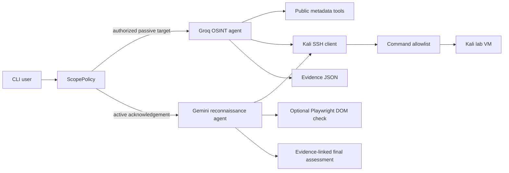

# AI Recon Agent

Authorization-first OSINT and technical reconnaissance for controlled security labs.

AI Recon Agent combines public metadata collection, a Kali Linux tool runner, and two language-model stages. The first stage uses Groq-compatible tool calling to collect bounded OSINT evidence. The second stage uses Gemini to plan a limited set of technical checks and produce an evidence-linked assessment.

> **Responsible-use notice:** Use this project only on systems you own or are explicitly authorized to test. The default policy accepts private or loopback lab targets. Public targets must be explicitly allowlisted, and active reconnaissance requires a separate acknowledgement.

## Key Features

- Normalizes and sanitizes HTTP(S), domain, IPv4, and IPv6 targets.
- Collects bounded DNS, RDAP, HTTP, TLS, RIPEstat, and Certificate Transparency metadata.
- Runs a restricted set of Kali tools over SSH: Nmap, curl, WhatWeb, dig, and a fixed OpenSSL certificate pipeline.
- Rejects arbitrary remote commands and shell control operators.
- Requires an explicit scope allowlist and active-reconnaissance acknowledgement.
- Links findings to evidence identifiers instead of presenting unsupported model claims.
- Removes secret-looking URL parameters and redacts sensitive values in errors and summaries.
- Produces JSON reports with coverage, limitations, decisions, and model-usage metadata.
- Supports optional local project inventory and dependency-audit evidence.

## Tech Stack

- Python 3.11+
- Groq through the OpenAI-compatible SDK
- Google Gemini through `google-genai`
- Paramiko SSH
- VirtualBox and a Kali Linux lab VM
- Nmap, curl, WhatWeb, dig, and OpenSSL inside Kali
- Optional Playwright browser inspection
- pytest, pytest-cov, and Ruff for quality checks

## Architecture



The agents do not grant models direct shell access. Model-selected actions are mapped to predefined functions. The SSH client validates every generated command against a read-only command policy before execution.

## Project Structure

```text
.
├── agenteAnalisis.py          # Groq OSINT agent and JSON evidence store
├── analisis.py                # Gemini planning, lab tools, and final assessment
├── ssh_client.py              # VirtualBox startup and strict Paramiko client
├── scope.py                   # Target allowlist and active authorization policy
├── command_policy.py          # Remote command validation
├── llm_utils.py               # Structured model-response validation
├── main.py                    # Interactive CLI
├── examples/
│   └── anonymized_report.json
├── tests/
└── .github/workflows/tests.yml
```

## Requirements

- Windows host with Python 3.11–3.13.
- VirtualBox installed when Kali-backed checks are required.
- A Kali VM reachable through SSH with its host key already trusted.
- Kali packages: `nmap`, `curl`, `whatweb`, `dnsutils`, and `openssl`.
- Separate development API keys for Groq and Gemini.

The OSINT helper tests and report parsing can run without a VM or API key.

## Installation

```powershell
python -m venv .venv
.\.venv\Scripts\Activate.ps1
python -m pip install --upgrade pip
python -m pip install -e ".[dev]"
```

Optional DOM inspection:

```powershell
python -m pip install -e ".[browser]"
python -m playwright install chromium
```

## Environment Configuration

Copy `.env.example` to `.env` and fill it with local development values. Never commit `.env`.

The most important safety settings are:

```dotenv
RECON_AUTHORIZED_TARGETS=localhost,127.0.0.1,app.lab.local
RECON_ACTIVE_ACK=I_HAVE_EXPLICIT_AUTHORIZATION
```

- Private/loopback targets are accepted as lab targets.
- A public hostname is rejected unless its exact hostname or a matching wildcard is in `RECON_AUTHORIZED_TARGETS`.
- Nmap, WhatWeb, remote HTTP/TLS checks, and the second agent are blocked unless `RECON_ACTIVE_ACK` has the exact documented value.
- Authorization is a technical safeguard, not a substitute for written permission.

## Running the Project

```powershell
python main.py
```

The CLI connects to one configured Kali VM, asks for a target, runs the OSINT stage, and then runs the active lab stage only if the scope policy permits it. Type `salir` to stop.

Reports are saved under `informes/`, which is excluded from Git because reports may contain target metadata.

## Usage Example

For a local lab web application:

```dotenv
RECON_AUTHORIZED_TARGETS=localhost
RECON_ACTIVE_ACK=I_HAVE_EXPLICIT_AUTHORIZATION
```

Then enter `http://localhost:8080` at the prompt. See [`examples/anonymized_report.json`](examples/anonymized_report.json) for a synthetic, non-sensitive output example.

## Testing

The test suite uses mocks and synthetic data. It does not contact public targets, start VirtualBox, or call paid model APIs.

```powershell
python -m pytest --cov --cov-report=term-missing
python -m ruff check --select E9,F63,F7,F82 .
python -m compileall -q .
```

Covered behavior includes:

- lab and allowlist scope decisions;
- explicit authorization for active checks;
- command allowlisting and shell-injection rejection;
- structured LLM response parsing;
- URL secret sanitization;
- Nmap XML conversion using a mocked Kali executor.

## API Documentation

This version is an interactive CLI, not an HTTP API. Its integration boundaries are Python classes:

- `AgenteOSINT.investigar(target)` returns evidence-backed OSINT JSON.
- `AgenteReconocimiento.analizar(osint_result)` returns the technical assessment.
- `KaliSSHClient.ejecutar_sudo(command)` accepts only commands approved by `command_policy.py`.

## Screenshots or Demo

No fabricated screenshots are included. A future demo should use a disposable local web application and show:

1. rejection of a non-allowlisted public target;
2. successful collection against a private lab target;
3. evidence IDs in the final assessment;
4. the anonymized JSON report.

## Security Considerations

- Never commit API keys, VM passwords, reports, SSH private keys, or database dumps.
- Use disposable, least-privilege model keys with spending limits.
- Keep strict SSH host-key verification enabled; add the lab VM host key to `known_hosts` out of band.
- Do not expose the command runner through a public API.
- Review generated reports before sharing; metadata can still identify systems.
- Rotate any credential that was previously stored in a local `.env` and may have been exposed elsewhere.

## Limitations

- The Nmap inventory covers only a fixed list of TCP ports and is not a complete security assessment.
- Tool output and model output are untrusted data and may be incomplete.
- No exploit validation, brute force, directory enumeration, credential submission, or denial-of-service testing is implemented.
- Optional dependency auditing reads local manifests but does not prove deployed versions.
- Live Kali, Groq, and Gemini integrations require local configuration and were intentionally separated from CI.
- The current CLI supports password-based SSH for existing student lab VMs; key-based authentication is a recommended improvement.

## Future Improvements

- Add key-based SSH authentication and per-tool least-privilege sudo rules.
- Add a non-interactive CLI with explicit `--target` and `--mode` arguments.
- Export Markdown/HTML reports from the validated JSON schema.
- Add contract tests for provider SDK updates.
- Add a disposable Docker/VM lab fixture for end-to-end tests.

## Authors and Contributions

- **Juan Diego Pinilla** — original academic implementation, agent workflow, OSINT collectors, and lab integrations.
- Portfolio hardening added authorization boundaries, command restrictions, test automation, safe configuration examples, and recruiter-facing documentation while preserving the original functionality and attribution.

